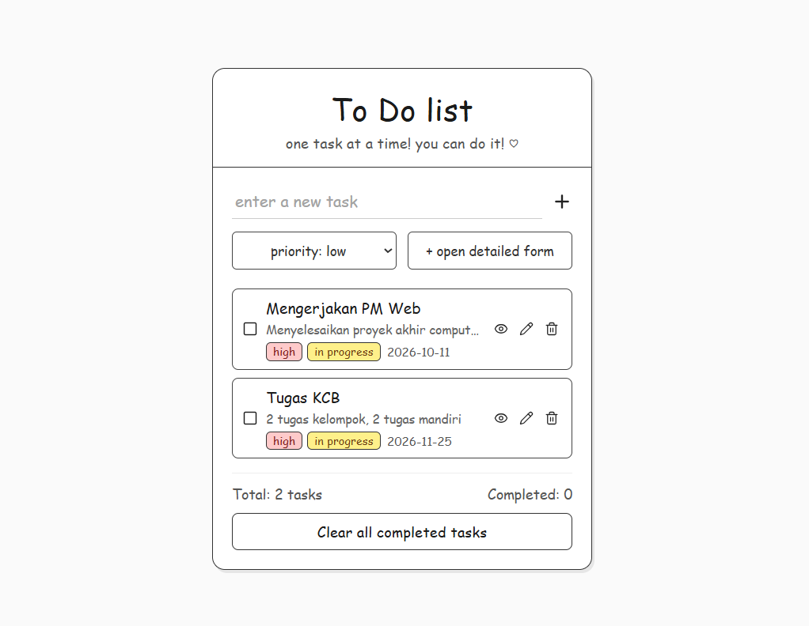
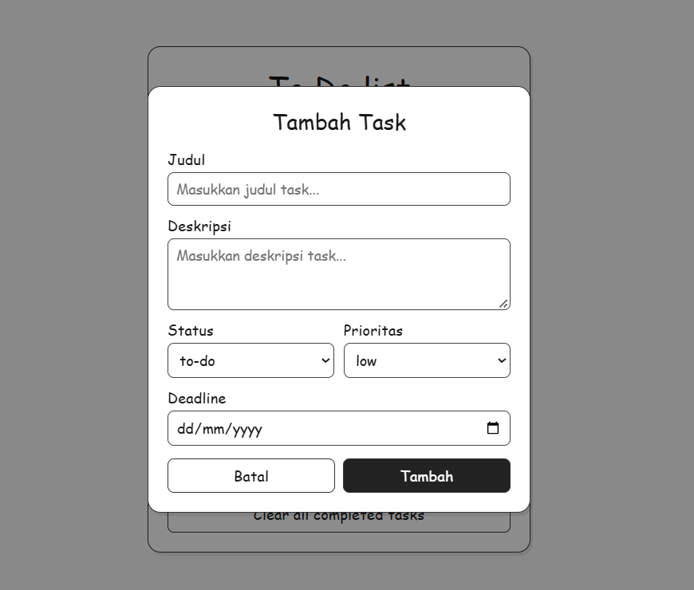
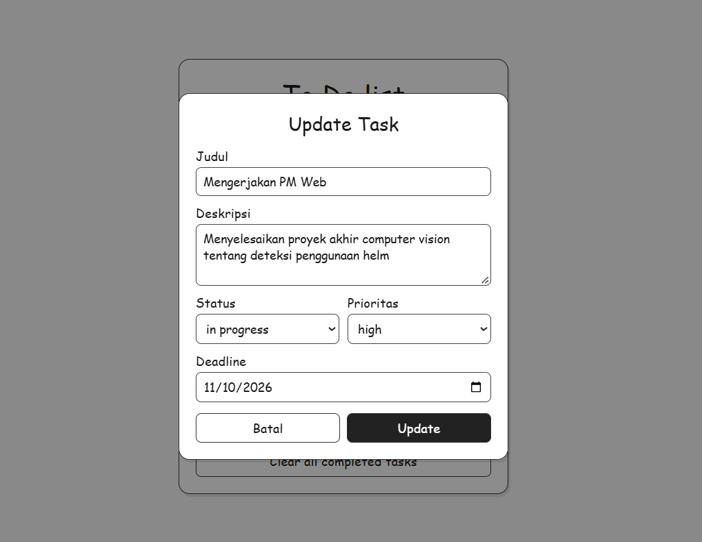

# Aplikasi To-Do List - React.js

Kuis Praktikum Pengembangan Frontend To-Do List menggunakan React.js.

## Fitur
- Menampilkan daftar tugas beserta status, prioritas, dan deadline
- Menambahkan tugas baru (quick input & form detail)
- Melihat detail tugas (`/todo/:id`)
- Mengedit & memperbarui data tugas
- Menghapus tugas dengan konfirmasi & menghapus semua tugas yang selesai

## Screenshot Implementasi

### Halaman Utama

### Tambah Task

### Update Task
